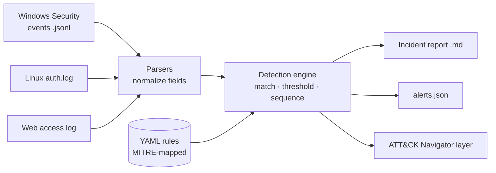

# SOC Detection Lab


A rule-based detection engine that reads Windows, Linux and web-server logs, detects attacker behavior mapped to **MITRE ATT&CK**, and writes an incident report like a SOC analyst would.

It ships with a realistic two-host attack scenario. One command shows the whole attack chain being caught: reconnaissance, SQL injection, brute force, account takeover, backdoor accounts, persistence and log clearing.

```text
$ python -m socdetect analyze sample_logs --year 2026

TIME (UTC)           SEVERITY  TECHNIQUE   DETECTION                                   HOST
2026-10-14 09:02:03  MEDIUM    T1595.003   Web directory scanning (burst of 404s)      web01
2026-10-14 09:05:10  HIGH      T1190       SQL injection attempt in URL                web01
2026-10-14 09:10:05  HIGH      T1110.001   SSH brute-force attack                      web01
2026-10-14 09:10:05  CRITICAL  T1078       Successful SSH login after brute force      web01
2026-10-14 09:13:21  HIGH      T1098       User added to Linux admin group             web01
2026-10-14 10:20:02  CRITICAL  T1078       Successful Windows logon after brute force  WS01.corp.local
2026-10-14 10:23:05  HIGH      T1059.001   Encoded PowerShell command                  WS01.corp.local
2026-10-14 10:28:02  HIGH      T1547.001   Registry Run key added                      WS01.corp.local
2026-10-14 10:30:45  HIGH      T1070.001   Security event log cleared                  WS01.corp.local
...
17 alerts. Reports written to reports/
```

📄 **[Read the generated incident report](docs/sample-report/incident_report.md)**

## Why I built this

SOC analysts spend their day turning raw logs into decisions: is this an attack, how far did it get, and what do we do now? I wanted to understand that process end to end, not just click through a SIEM. So I built the pieces myself: log parsing, detection logic, correlation and reporting.

## Features

- **Three log sources:** Windows Security events (JSON Lines), Linux `auth.log`, and Apache/Nginx access logs, all normalized to one schema
- **15 detection rules** in YAML (Sigma-style), each mapped to a MITRE ATT&CK tactic and technique, with false-positive notes and response steps
- **Three detection types:**
  - `match`: a single suspicious event (new admin account, log cleared)
  - `threshold`: N events from one source in a time window (brute force, web scanning)
  - `sequence`: correlation of a threshold followed by another event (brute force **then** a successful login)
- **Tuning with filters:** exclude known-good activity to cut false positives
- **Analyst helpers:** encoded PowerShell is decoded automatically; evidence lines point back to the exact file and line
- **Three outputs:** an incident report (Markdown), alerts in JSON for other tools, and a layer for [MITRE ATT&CK Navigator](https://mitre-attack.github.io/attack-navigator/)
- **Pipeline-ready:** `--fail-on high` returns exit code 1, so it can gate a CI job
- **Tested:** 38 tests, including an end-to-end check that every rule fires on the attack and nothing fires on normal activity; GitHub Actions runs them on every push

## How it works



1. **Parse:** each log format is converted to a common event with fields like `host`, `user`, `src_ip`, `action`, `event_id` and `command_line`.
2. **Detect:** every rule's selection is checked against events from its log source. Threshold and sequence rules group events by a key (usually `src_ip`) and use a sliding time window.
3. **Report:** alerts are sorted into a timeline, mapped to ATT&CK tactics, and written up with evidence and response steps.

## Detection coverage

| Tactic | Technique | Rule | Log source |
| --- | --- | --- | --- |
| Reconnaissance | T1595.003 Wordlist Scanning | Burst of 404s from one IP | Web |
| Initial Access | T1190 Exploit Public-Facing Application | SQL injection in URL | Web |
| Initial Access | T1078 Valid Accounts | Successful login after brute force | Linux, Windows |
| Credential Access | T1110.001 Password Guessing | SSH / Windows logon brute force | Linux, Windows |
| Execution | T1059.001 PowerShell | Encoded PowerShell command | Windows |
| Command and Control | T1105 Ingress Tool Transfer | PowerShell download cradle (IEX + DownloadString) | Windows |
| Persistence | T1136.001 Create Local Account | New user account | Linux, Windows |
| Persistence | T1098 Account Manipulation | User added to sudo / Administrators | Linux, Windows |
| Persistence | T1053.005 Scheduled Task | Scheduled task created (SYSTEM filtered) | Windows |
| Persistence | T1547.001 Registry Run Keys | `reg add ...\CurrentVersion\Run` | Windows |
| Defense Evasion | T1070.001 Clear Windows Event Logs | `wevtutil cl Security` | Windows |

## The attack scenario

`sample_logs/` holds a synthetic incident (generated by [`tools/generate_sample_logs.py`](tools/generate_sample_logs.py); all IPs are from RFC 5737 documentation ranges):

| Time (UTC) | Host | What the attacker did |
| --- | --- | --- |
| 09:02 | web01 | Scanned the website for hidden pages with gobuster |
| 09:05 | web01 | Tried SQL injection on `/products` with sqlmap |
| 09:10 | web01 | Brute-forced SSH and logged in as `webadmin` |
| 09:13 | web01 | Created a `sysupdate` account and added it to `sudo` |
| 10:20 | WS01 | Guessed the Administrator password, then logged on over RDP |
| 10:23 | WS01 | Ran encoded PowerShell (recon), then downloaded a script into memory |
| 10:25 | WS01 | Created `svc_backup` and added it to Administrators |
| 10:27 | WS01 | Added a scheduled task and a Registry Run key for persistence |
| 10:30 | WS01 | Cleared the Security event log |

Normal activity is mixed in: staff logins, a deploy, cron jobs, users mistyping passwords, regular web traffic and a built-in Windows task. None of it raises an alert.

## Quick start

Requires Python 3.10+.

```bash
git clone https://github.com/tbabaria24-bit/soc-detection-lab.git
cd soc-detection-lab
python3 -m venv .venv && source .venv/bin/activate
pip install -r requirements-dev.txt

python -m socdetect analyze sample_logs --year 2026   # run the scenario
python -m socdetect rules                             # list the rules
python -m pytest                                      # run the tests
```

Useful options:

```bash
python -m socdetect analyze /var/log/auth.log --out reports/   # your own logs
python -m socdetect analyze sample_logs --min-severity high    # only high and critical
python -m socdetect analyze sample_logs --fail-on critical     # exit 1 if anything critical
```

## Writing a rule

Rules live in `rules/`. This one catches SSH brute force:

```yaml
id: linux_ssh_bruteforce
title: SSH brute-force attack
severity: high
logsource: linux
mitre:
  tactic: Credential Access
  technique_id: T1110.001
  technique: "Brute Force: Password Guessing"
detection:
  type: threshold
  selection:
    action: ssh_failed
  threshold:
    group_by: [src_ip]
    count: 5
    window_seconds: 300
response:
  - Block the IP and disable SSH password login in favor of keys.
```

Field modifiers: `contains`, `startswith`, `endswith`, `re` (regex), `gte`, `lte`. All fields in a selection must match; a list of values means any one of them. Add a `filter:` block to exclude known-good events. Run `python -m socdetect validate` to check your rule.

## Project structure

```text
socdetect/
  parsers.py     log parsers -> normalized events
  engine.py      rule loading, validation and detection logic
  report.py      incident report, JSON alerts, ATT&CK Navigator layer
  __main__.py    command-line interface
rules/           15 YAML detection rules
sample_logs/     synthetic attack scenario (Windows, Linux, web)
tools/           scenario generator
tests/           unit and end-to-end tests
docs/            sample generated report
```

## Roadmap

- [ ] Run it against real logs from my Azure homelab (Windows Server domain + Ubuntu), exported with PowerShell
- [ ] Add rules for Kerberoasting (4769) and pass-the-hash patterns
- [ ] Send critical alerts to a Discord or Slack webhook

## What I learned

<!-- Write this section in your own words after you run the project. Ideas to cover:
     - What surprised you about how attacks look in raw logs
     - Why correlation (brute force -> success) matters more than single events
     - A false positive you found and how the filter fixed it
     - How you'd change it for a real SOC -->

## License

MIT
